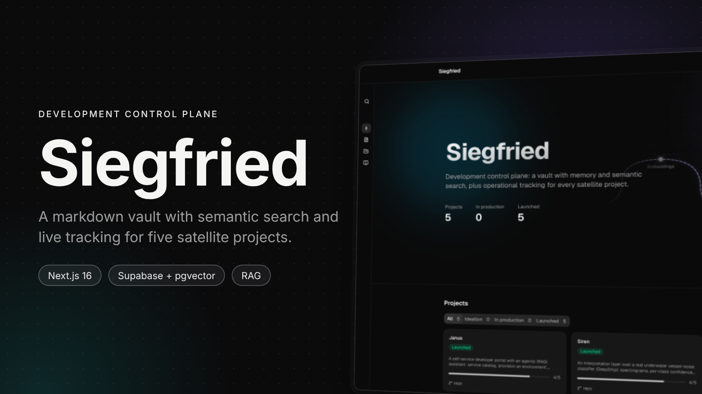
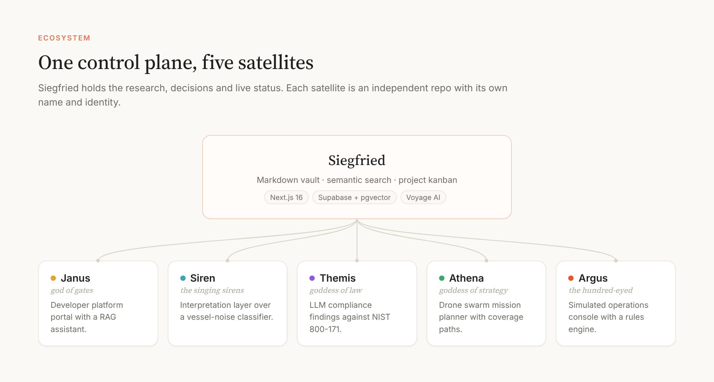
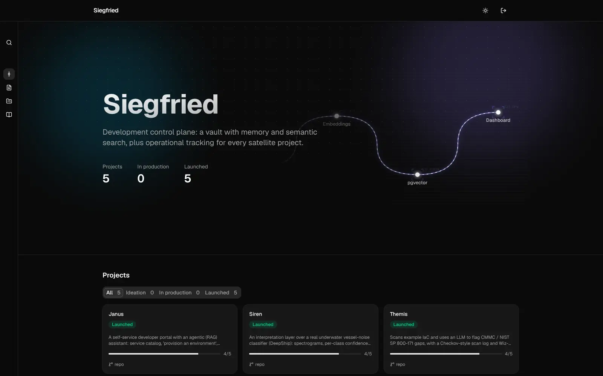
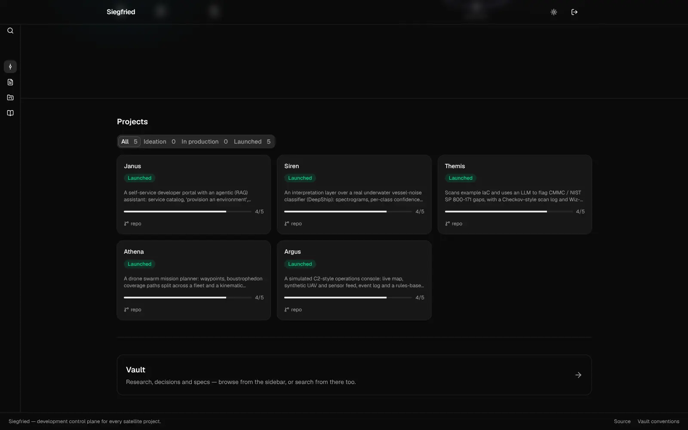
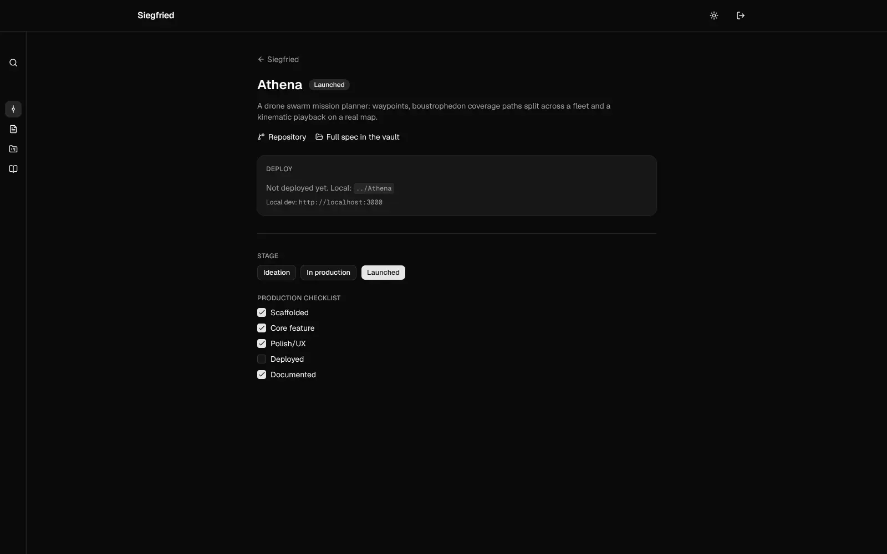
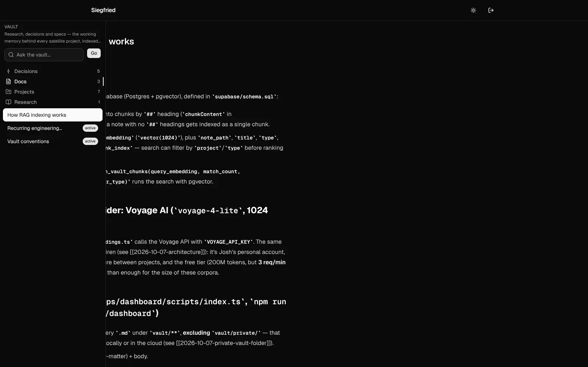
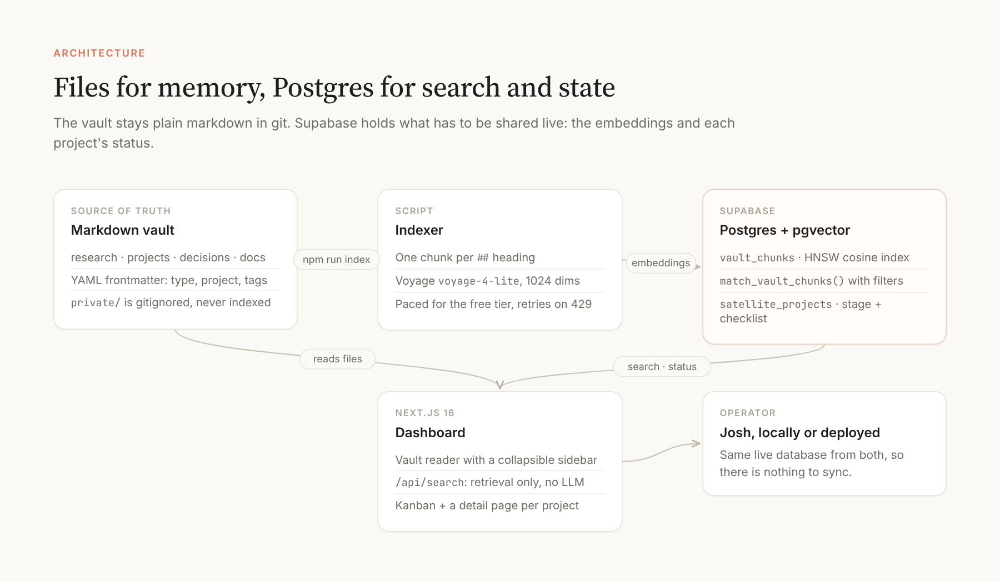
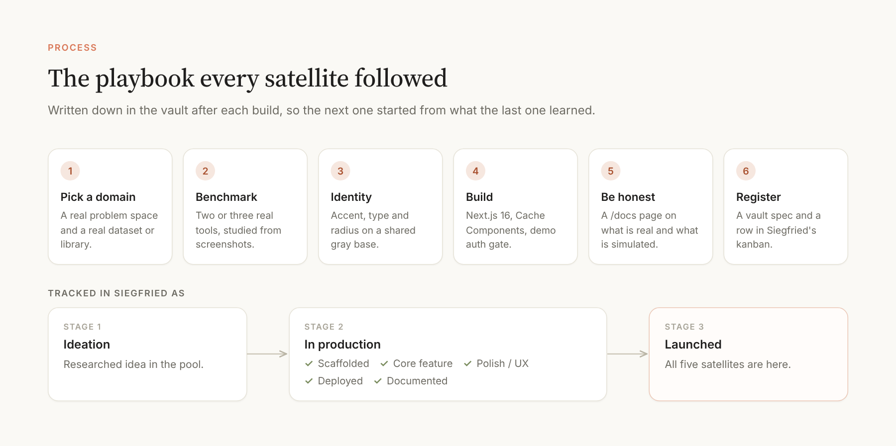
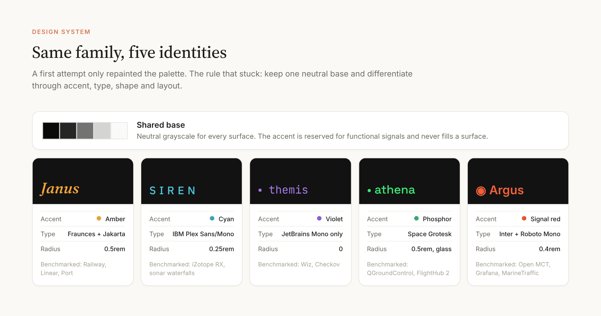

# Siegfried



**A development control plane.** Siegfried is the base I built to research, document and ship a series of five small products. It is three things in one Next.js app: a markdown vault that works as long-term memory, semantic (RAG) search over that vault, and an operational dashboard that tracks every satellite project from idea to launch.

Case study: [joshrubio.es/projects/siegfried](https://joshrubio.es/projects/siegfried)

## The satellites

Each satellite lives in its own repository, with its own mythological name and its own visual identity. They share patterns, not code.



| Project | What it is | Repo |
|---|---|---|
| **Janus** | A developer platform portal with a RAG assistant over its own docs. | [joshrubio/Janus](https://github.com/joshrubio/Janus) |
| **Siren** | An interpretation layer over a real underwater vessel-noise classifier. | [joshrubio/Siren](https://github.com/joshrubio/Siren) |
| **Themis** | LLM-generated NIST SP 800-171 findings on infrastructure-as-code. | [joshrubio/Themis](https://github.com/joshrubio/Themis) |
| **Athena** | A drone swarm mission planner with real coverage-path geometry. | [joshrubio/Athena](https://github.com/joshrubio/Athena) |
| **Argus** | A simulated operations console with an explainable rules engine. | [joshrubio/Argus](https://github.com/joshrubio/Argus) |

All five are built and tracked as *launched*.

## The dashboard



- **Home**: live counts and a project grid filtered by stage (ideation, in production, launched), with each card showing its checklist progress.
- **Project detail** (`/projects/[slug]`): links to the repo and the vault spec, deploy state, a stage selector and an editable five-item checklist (scaffolded, core feature, polish/UX, deployed, documented). Changes are written straight to Supabase.
- **Vault** (`/vault`): a reader for every note, with a sidebar that expands on hover and a search box that queries the RAG index.

| Projects | Project detail | Vault |
|---|---|---|
|  |  |  |

## Architecture



- **Vault** (`vault/`): markdown with YAML frontmatter, split into `research/`, `projects/`, `decisions/` and `docs/`. It stays the source of truth and is versioned in git. See [`vault/docs/vault-conventions.md`](vault/docs/vault-conventions.md).
- **Indexer** (`apps/dashboard/scripts/index.ts`): one chunk per `##` heading, embedded with Voyage AI (`voyage-4-lite`, 1024 dimensions), paced for the free tier with retry on rate limits. See [`vault/docs/rag-indexing.md`](vault/docs/rag-indexing.md).
- **Supabase** (Postgres + pgvector): `vault_chunks` with an HNSW cosine index and a `match_vault_chunks()` function with optional project/type filters, plus the `satellite_projects` table that holds each project's stage and checklist.
- **Search** (`/api/search`): retrieval only. It returns ranked chunks, not generated text; the vault is for finding notes, not chatting with them.
- **Access**: a cookie gate in `proxy.ts`. The Supabase secret key (new `sb_secret_...` format) is only used on the server.

Local and production point at the same Supabase instance, so there is no sync step.

### Private notes

`vault/private/` (research on specific employers) and `guides/` are gitignored. They stay on disk and are never pushed or indexed.

## The satellite playbook



Every satellite followed the same steps, and every gotcha found along the way was written back into [`vault/docs/satellite-engineering-patterns.md`](vault/docs/satellite-engineering-patterns.md): Next.js 16 with Cache Components, MapLibre under Turbopack, lint traps, precomputing small corpora instead of standing up a database, and delegating a whole build to a remote agent (Argus).



Each identity keeps a shared neutral base and differs in accent, type, radius and layout, benchmarked against two or three real products in its domain. See [`vault/decisions/2026-10-07-satellite-identities.md`](vault/decisions/2026-10-07-satellite-identities.md).

## Structure

```
Siegfried/
├── vault/              # markdown memory: research, projects, decisions, docs (private/ is gitignored)
├── apps/dashboard/     # Next.js 16 app: dashboard, project pages, vault reader, RAG search
├── supabase/schema.sql # pgvector + vault_chunks + match_vault_chunks + satellite_projects
└── .env.example
```

Satellite repos live as sibling folders on disk (never nested, never submodules).

## Running locally

1. Create a Supabase project and run [`supabase/schema.sql`](supabase/schema.sql) in its SQL editor. It enables `pgvector` and creates `vault_chunks`, `match_vault_chunks` and `satellite_projects`. Everything goes through the Supabase JS client, so no connection string is needed.
2. Copy the env template into the app and fill in the Supabase and Voyage keys. The project uses Supabase's new key format (`sb_secret_...`), not the legacy `service_role` JWT (see [`vault/decisions/2026-10-07-supabase-key-format.md`](vault/decisions/2026-10-07-supabase-key-format.md)).
   ```bash
   cd apps/dashboard
   cp ../../.env.example .env.local
   npm install
   ```
3. Seed the project table once, then index the vault (uses Voyage tokens and pauses between notes for the free tier's rate limit):
   ```bash
   npm run seed-projects
   npm run index
   ```
4. Start the app:
   ```bash
   npm run dev
   ```

Re-run `npm run index` after editing the vault; there is no file watcher yet.

## Stack

Next.js 16 (App Router, Cache Components) · TypeScript · Tailwind CSS v4 · shadcn/ui · Supabase (Postgres + pgvector) · Voyage AI embeddings.
